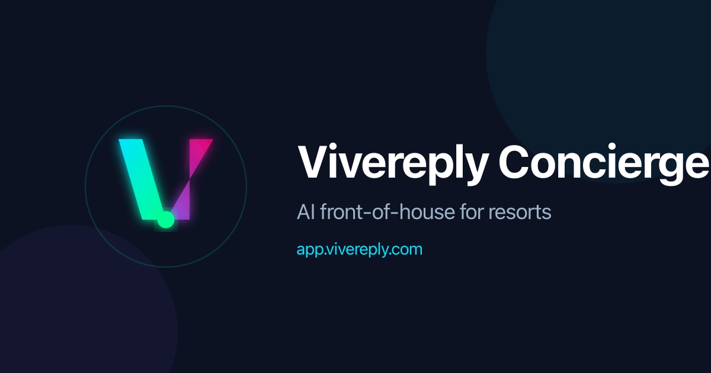

# Vivereply Concierge



AI front-of-house for resorts — a chat that checks live availability,
quotes exact prices, holds booking drafts, answers property questions from
its own knowledge, verifies bookings privately, and hands complex cases to
staff with the full conversation. One product, many resorts: every property
gets its own rooms, booking backend, knowledge, voice, staff scope, and
logins.

Built for the **Meta Global AI Developer Hackathon** (Startup track,
"Build for Your World"). Pre-existing: Vivereply Suite and the demo1
resort site. Built during the hackathon (Oct 26 – Nov 4, 2026): this
Concierge service — multi-tenant chat, agent tools, quote/rate layer,
staff page + bridge + widget, settings, onboarding/RAG, and the auth
core. The demo properties are fictional, not real resorts.

## What it does

- **Chat** (`/`) — bilingual English/Bengali. Language follows the
  guest's latest real language; the taka sign (৳) alone never flips it.
  Signed-in owners chat with their own resort; visitors get the demo.
- **Agent tools, via Muse Spark on the Meta Model API** — the model
  acts, it doesn't just answer:
  - `check_availability` — live units from the property's backend
  - `get_quote` — exact quote from catalogue prices + rate rules
  - `create_booking_draft` — holds a room (PENDING, no payment), only
    after the guest confirms the quote and gives name, email, phone
  - `request_handoff` — passes the conversation to staff with a summary
  - `lookup_booking_by_code`, `request_booking_details`, `verify_booking`
    — the privacy-safe verification loop
- **Cards** — quote, draft (with booking code, plus a "Suite total
  governs" warning if it ever differs from the quote), and handoff
  cards, built only from that turn's tool logs.
- **Tenants** — each resort is isolated by property: rooms, backend,
  knowledge, voice, staff, logins. Owners touch only their property
  (cross-property reads answer 404); registration is Vivereply-team-only,
  there is no public signup.
- **Suite backends** — any backend implementing `docs/suite-api-spec.md`
  plugs in per property (URL + encrypted key + catalogue, Test
  connection, failure health). Test properties run on the labeled
  fixture backend (`FIX-` codes, deterministic, in-memory).
- **Staff page** (`/staff`) — one property's handoffs, newest first,
  with the full transcript. Login-protected, owner-scoped.
- **Staff bridge (server API)** — client dashboards list, read, assign,
  close, and annotate handoffs as JSON, guarded by per-property keys
  minted in Settings. See `docs/bridge-integration.md`.
- **Staff widget (iframe)** — the staff loop embeddable in a client
  dashboard: the dashboard server mints a 15-minute origin-bound token
  per page load and renders the iframe. The bridge key never reaches
  the browser.
- **Settings** (`/settings`) — the single configuration surface, one
  property at a time: widget codes, domains, bridge codes + widget
  snippets, keys, Suite connections, catalogues, security board,
  profile + password change. Secrets and Appearance are honest Later
  rooms.
- **Admin** (`/admin`, super-admin only) — cross-property oversight:
  properties & owners, onboarding re-run approvals, backend failures.
  Registration UI (`/admin/register`) creates property + owner login
  with a shown-once temporary password.
- **Onboarding** (`/onboarding`) — one budgeted run per property builds
  its vector knowledge from a business form, website, and uploads.
  A Modal Python worker owns fetch/parse/chunk/embed/store behind
  SSRF guards; chunks stay invisible until clean completion. One run
  per client unless super-admin approves more. See `docs/onboarding.md`.
- **RAG grounding (supporting only)** — property questions are answered
  from that property's indexed knowledge via pgvector + Gemini
  embeddings, similarity ≥ 0.45, top 4. Below threshold the agent says
  it does not know and offers a handoff. Prices and availability never
  come from RAG — the backend tools govern those.

## Honesty rules (non-negotiable)

Never invent a room, price, availability, booking, or property fact.
A quote is shown before any draft; one draft per conversation; the
Suite total governs on any mismatch; anything unknown goes to staff.
Verification shows dates + first name + status by code, and nothing by
contact — details go only to the email already on the booking.

## Stack

Next.js (App Router) + TypeScript + Tailwind. Supabase Postgres +
Prisma 7 + pgvector, the Concierge's own database — it never shares
a Suite database, it talks to backends over HTTP only. Answering model:
Muse Spark via the Meta Model API, with an env-gated fallback to
Baseten-hosted Muse Spark Open (`meta-models/muse-spark-open-1026`) when
the primary errors — one retry, logged, inert without `BASETEN_API_KEY`.
Embeddings only: Gemini gemini-embedding-001 at 768 dimensions (the Meta
API lists no embedding model). Ingestion worker: Modal (Python, CPU).

## Setup

```bash
cp .env.example .env.local   # then fill it in; never commit .env*
pnpm install
```

Environment (see `.env.example` for the full list):

- `META_API_KEY` — Meta Model API key (starts `LLM_`)
- `BASETEN_API_KEY` — optional fallback backend (demo insurance only)
- `META_API_BASE_URL`, `META_MODEL` — provider endpoint + agent model
- `SUITE_API_BASE_URL` — demo Suite deployment (demo1, fallback)
- `DEMO_PROPERTY_ID` — demo property slug
- `DATABASE_URL` — Supabase transaction pooler (port 6543, runtime)
- `DIRECT_URL` — Supabase session pooler (port 5432, migrations)
- `GEMINI_API_KEY` — Google AI Studio, embeddings only
- `ADMIN_EMAIL` + `ADMIN_PASSWORD` — founder bootstrap login (super-admin)
- `SESSION_SECRET` — signs sessions + tokens (≥16 chars; unset in
  production fails login and chat closed)
- `BINDING_SECRET_KEY` — encrypts backend keys at rest (≥32 chars)
- `SUPABASE_URL`, `SUPABASE_SERVICE_KEY` — Storage signing (server only)
- `WORKER_SHARED_SECRET`, `MODAL_WORKER_URL` — RAG worker auth + endpoint
- Seed-tenant logins live inline in `prisma/seed-tenants.mjs` (test
  tenants only — see `docs/seed-users.md`); no password env vars

Then, in order:

```bash
# 1. Enable pgvector in the Concierge Supabase project:
#    Dashboard → SQL Editor → CREATE EXTENSION IF NOT EXISTS vector;
pnpm exec prisma generate
pnpm exec prisma db push   # uses DIRECT_URL via prisma.config.ts
# 2. Register tenants: fill owner emails + passwords in
#    prisma/seed-tenants.mjs (see docs/seed-users.md), then
pnpm seed:tenants          # needs database access
pnpm dev                   # http://localhost:3000
```

Standalone scripts must import `lib/env` first, before `lib/prisma` —
`tsx` does not load `.env` files by itself, and the Prisma Pool is
created at import time.

## Widget (embed on any site)

```html
<script src="https://<your-concierge-host>/widget.js" data-key="<property-key>"></script>
```

That one script tag adds a floating Chat button and an iframe panel
loading `/widget?key=…` from the Concierge host — the same chat as `/`,
in compact mode. The script derives its origin from its own `src`, so it
works on localhost and on a deployment with no code change. The key is a
public label, not a secret: each seeded property has its own key (see
Settings → Chat widget codes); an unknown key shows a "not configured"
panel, never a guessed property.

## Security

- **Logins**: owners sign in with email + scrypt password (seeded or
  registered by super-admin, temp password shown once, must-change
  banner until replaced). The founder bootstrap is `ADMIN_EMAIL` +
  `ADMIN_PASSWORD` (env, checked first). Sessions are signed cookies bound to
  server-side rows — revocable per session (logout), per user
  (password change, admin kill-switch), with 7-day absolute + 24-hour
  idle expiry. The founder bootstrap is password-only via env.
- **Login throttle**: 5 failures/15 min per email or 20 per IP → 429.
- **Approved domains (Settings)**: only hosts listed there (and still
  active) can embed the widget for a property. Deactivating a domain
  stops its widget on the next chat message.
- **Widget token handshake**: `widget.js` asks `/api/widget-token`
  from the host page, and the browser attaches the host page's Origin.
  Only an approved origin gets a short-lived signed token, and
  `/api/chat` verifies that token — and re-checks domain approval —
  on every message. The token's propertyId governs; a propertyId sent
  by the browser is ignored. `/` issues a direct token server-side
  and needs no approved domain.
- **Bridge**: per-property keys, hashed at rest, revocable instantly,
  never in the browser. Staff widget tokens live 15 minutes and are
  origin-bound (strict Referer check at iframe load).

Honest limits: no 2FA, no public signup (by design — registration is
team-only), no frame-ancestors allowlist on the staff widget (token +
origin binding is the gate). Localhost is approved automatically in
development only. Post-hackathon: Supabase Auth migration, 2FA, audit
log, per-domain frame-ancestors.

## Demo flow to try

1. Sea-facing room, 2 nights, ~৳15,000/night → quote card, then
   confirm + details → draft card with booking code.
2. Bengali cottage conversation + halal-food question → grounded
   Bengali answer.
3. 25-person group rate → no invented rate, handoff card, and the
   case appears at `/staff` with the transcript.
4. Second property (Seabreeze, fixture backend): Harbor Suite 2 nights
   → ৳25,000 quote → `FIX-` draft → lookup round-trip — then confirm
   neither property sees the other's data.
